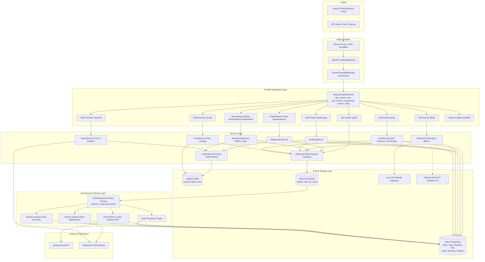
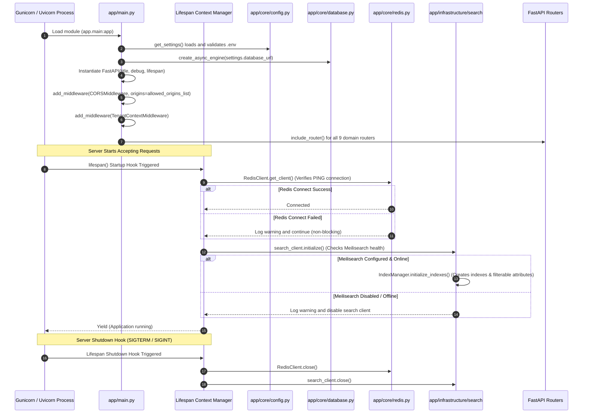
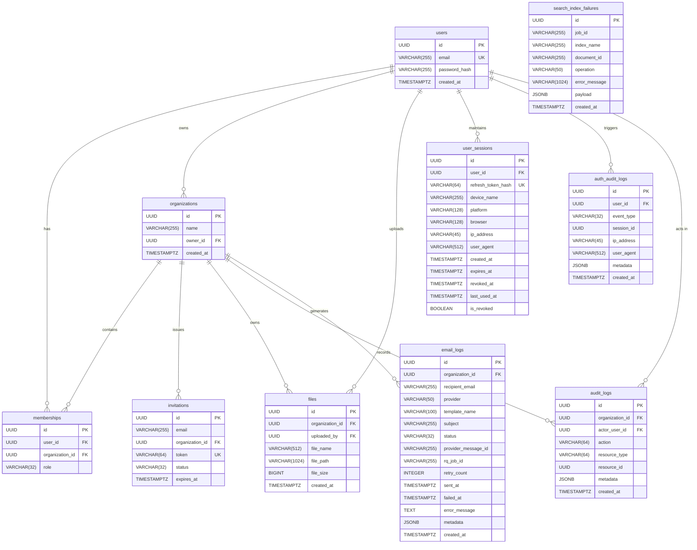
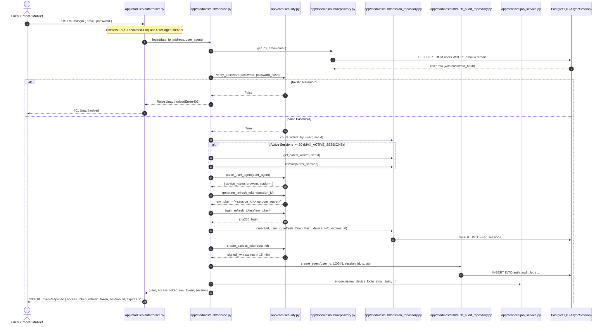
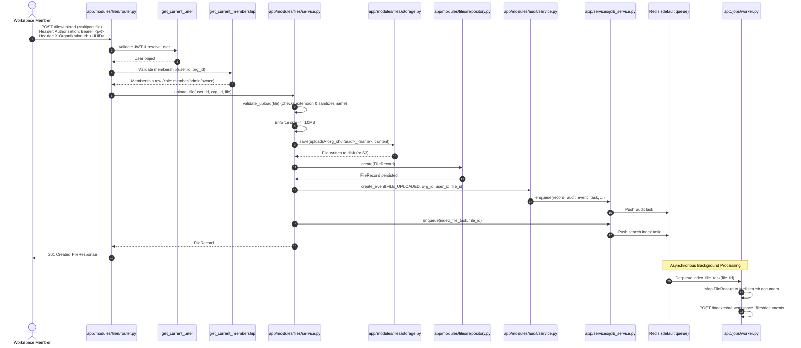
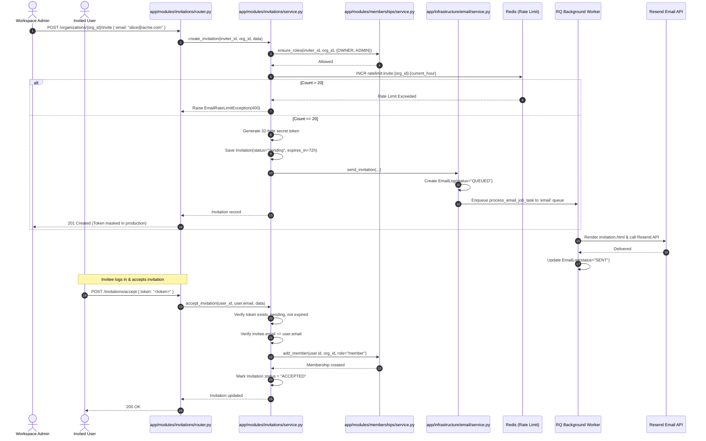

# PROJECT OVERVIEW: AI Workspace SaaS Backend & Frontends

> **Technical Audit Document**  
> **Repository:** `FastAPI-Tenant`  
> **Software Version:** `2.5.0` (API Runtime) / `2.4.0` (Core Engine / `VERSION` file)  
> **Audit Date:** November 2026  
> **Auditor:** Senior Software Architect  

---

## 1. Project Summary

### 1.1 Core Mission and Problem Solved
`FastAPI-Tenant` (branded in code and configuration as **AI Workspace SaaS Backend**) is an enterprise-ready, asynchronous multi-tenant workspace platform built primarily with **FastAPI**, **SQLAlchemy (AsyncIO)**, **PostgreSQL**, **Redis**, **RQ (Redis Queue)**, and **Meilisearch**. 

Multi-tenant B2B SaaS platforms require strict data isolation, role-based access control (RBAC), secure authentication with multi-device session management and replay attack protection, asynchronous background worker offloading for heavy I/O tasks, audit event logging, and full-text search across tenant resources. This repository solves these challenges by implementing:
- **Tenant Isolation**: Shared-database, tenant-identifier isolation enforced at both the HTTP request layer (via header extraction and FastAPI dependencies) and the database query layer (scoping queries strictly by `organization_id`).
- **Comprehensive RBAC**: Granular role hierarchy (`owner`, `admin`, `member`) with ownership transfer and self-removal guardrails.
- **Enterprise Session Security**: Dual-token authentication (short-lived JWT access tokens and long-lived rotating refresh tokens stored as SHA-256 digests in `user_sessions`), device detection from User-Agent strings, replay attack detection with instant session revocation, and active session limits.
- **Dual Asynchronous Engine**: FastAPI handles asynchronous HTTP I/O (`asyncio` / `asyncpg`), while an RQ-based worker daemon backed by Redis handles decoupled tasks (audit logging, search indexing, and multi-mode email dispatch).
- **Graceful Search Degradation & Circuit Breaking**: Meilisearch Cloud integration with an in-memory circuit breaker and database fallback table (`search_index_failures`) ensuring the platform remains fully functional when search is offline.
- **Modern Frontend SPA**: A production-grade React 19 + TypeScript + Vite Single Page Application (SPA) in `frontend-react/` with Tailwind CSS and TanStack Query.

### 1.2 Target Users
- **Workspace Owners**: Create organizations, manage membership, promote administrators, revoke members, and transfer tenant ownership.
- **Workspace Administrators**: Invite new members, resend invitations, monitor audit logs, upload and manage organizational assets.
- **Workspace Members**: Access tenant-scoped files, search workspace content, view team members, and inspect organization activity.
- **Platform Developers & DevOps**: Monitor worker pools, inspect background queues, view real-time system health, and audit user device sessions.

### 1.3 Current Status and Maturity
- **Maturity**: Production Ready (Version `2.5.0`).
- **Test Suite**: 146 unit, integration, and security tests in `app/tests/` passing with 100% pass rate.
- **Infrastructure**: Containerized with a multi-stage Docker build (`Dockerfile`), configured for deployment via Render (`render.yaml`) using Neon PostgreSQL, Upstash Redis, and Meilisearch Cloud, with continuous integration automated via GitHub Actions (`.github/workflows/ci.yml`).

---

## 2. Tech Stack

| Category | Technology | Version / Spec | Purpose |
| :--- | :--- | :--- | :--- |
| **Language (Backend)** | Python | `>= 3.12` (Tested on 3.12.13) | Core backend language |
| **API Framework** | FastAPI | `>= 0.115.0` | Asynchronous web framework & OpenAPI documentation |
| **ASGI Server** | Uvicorn (standard) | `>= 0.32.0` | High-performance ASGI runtime worker |
| **WSGI / Process Manager** | Gunicorn | `>= 22.0.0` | Production UNIX process supervisor managing Uvicorn workers |
| **Database ORM** | SQLAlchemy (asyncio) | `>= 2.0.36` | Asynchronous Object-Relational Mapping (Declarative) |
| **Database Drivers** | asyncpg / psycopg2-binary | `asyncpg>=0.30.0`, `psycopg2-binary>=2.9.10` | `asyncpg` for FastAPI async queries; `psycopg2` for Alembic migrations |
| **Schema Migrations** | Alembic | `>= 1.14.0` | Relational database schema migrations |
| **Validation & Settings** | Pydantic / Pydantic-Settings | `pydantic>=2.10.0`, `pydantic-settings>=2.6.0` | Data modeling, validation, and environment configuration |
| **Security & Cryptography** | python-jose / passlib / bcrypt | `python-jose[cryptography]>=3.3.0`, `passlib[bcrypt]>=1.7.4`, `bcrypt>=4.0.1,<4.1.0` | JWT encoding/decoding, HS256 signing, bcrypt password hashing |
| **Cache & In-Memory Store** | Redis (with hiredis) | `redis[hiredis]>=5.2.0` | Cache-aside layer, distributed rate limiting, and session cache |
| **Task Queue / Background Jobs** | RQ (Redis Queue) | `>= 2.1.0` | Redis-backed asynchronous task queue and retry supervisor |
| **Search Engine** | Meilisearch Cloud API | REST API / `httpx>=0.28.0` | Ultra-fast lexical typo-tolerant search and indexing |
| **Email Infrastructure** | Resend / Console | Resend REST API | Transactional emails (invites, new-device alerts) with console fallback |
| **Template Engine** | Jinja2 | `>= 3.1.0` | HTML and plaintext email template rendering |
| **Device Detection** | user-agents | `>= 2.2.0` | HTTP User-Agent parsing for device, browser, and OS detection |
| **Cloud Object Storage** | boto3 | `>= 1.34.0` | Optional S3 / Cloudflare R2 object storage driver |
| **Testing Suite** | pytest / pytest-asyncio / aiosqlite | `pytest>=8.3.0`, `pytest-asyncio>=0.24.0`, `aiosqlite>=0.20.0` | Async unit/integration testing with in-memory SQLite isolation |
| **Frontend SPA (React)** | React / TypeScript / Vite | `React 19.2.8`, `Vite 8.2.0`, `TypeScript ~6.0.2` | Primary production single-page application |
| **Frontend Styling & UI** | Tailwind CSS / Lucide / Framer Motion | `@tailwindcss/vite 4.3.3`, `lucide-react 1.28.0`, `framer-motion 12.43.0` | Utility-first modern UI components and transitions |
| **Frontend State & Queries** | TanStack React Query / Axios | `@tanstack/react-query 5.101.4`, `axios 1.19.0` | Client-side caching, mutation management, and HTTP client |
| **Frontend Forms & i18n** | React Hook Form / Zod / i18next | `react-hook-form 7.84.0`, `zod 3.25.76`, `i18next 26.3.6` | Client-side validation schemas and multi-language support |

---

## 3. Repository Structure

```
FastAPI-Tenant/
├── .dockerignore                     # Docker build exclusion rules
├── .env                              # Local active environment variables (untracked in VCS)
├── .env.example                      # Production environment configuration template
├── .github/
│   └── workflows/
│       └── ci.yml                    # GitHub Actions workflow: backend tests, frontend build, docker build
├── .gitignore                        # Git exclusion rules
├── alembic.ini                       # Alembic CLI migration configuration
├── alembic/
│   ├── env.py                        # Alembic migration environment runtime (reads settings.sync_database_url)
│   ├── script.py.mako                # Template for generating new Alembic migration scripts
│   └── versions/                     # Schema version history
│       ├── 20260517_0001_initial_schema.py             # Creates users, organizations, memberships, invitations, files
│       ├── 20260719_0002_add_file_size.py              # Adds file_size column to files table
│       ├── 20260721_0003_add_audit_logs.py             # Creates audit_logs table with composite indexes
│       ├── 20260801_0004_add_search_index_failures.py  # Creates search_index_failures dead-letter table
│       ├── 20260802_0005_add_email_logs.py             # Creates email_logs table with status enum
│       └── 20260802_0006_add_user_sessions_auth_audit.py # Creates user_sessions and auth_audit_logs tables
├── app/
│   ├── __init__.py                   # App package initialization
│   ├── main.py                       # FastAPI application instance, lifespan hooks, CORS, and router registration
│   ├── models.py                     # Central registry importing all SQLAlchemy ORM models for Alembic discovery
│   ├── core/                         # Core infrastructure and foundation services
│   │   ├── __init__.py
│   │   ├── cache.py                  # CacheService (Cache-Aside), RedisService, CacheKeyBuilder, and CacheTTL
│   │   ├── config.py                 # Pydantic Settings class reading .env with computed properties
│   │   ├── database.py               # Async SQLAlchemy engine, session maker, Base declarative class, get_db dependency
│   │   ├── dependencies.py           # Security dependencies: get_current_user, get_organization_id_header, require_roles
│   │   ├── exceptions.py             # Custom HTTP exceptions (NotFoundError, ConflictError, ForbiddenError, etc.)
│   │   ├── redis.py                  # Async RedisClient singleton managing connection pools and TLS configuration
│   │   ├── request_context.py        # RequestInfo dependency extracting real client IP and User-Agent
│   │   ├── rq.py                     # Synchronous Redis connection factory and RQ Queue getters
│   │   └── security.py               # Password hashing, JWT creation/decoding, refresh token generator, UA parser
│   ├── infrastructure/               # External third-party integrations
│   │   ├── email/
│   │   │   ├── client.py             # Email provider factory (Resend vs ConsoleProvider)
│   │   │   ├── console_provider.py   # Development and test email provider outputting to logs
│   │   │   ├── exceptions.py         # EmailException and EmailRateLimitException
│   │   │   ├── health.py             # Email health checker with 60-second caching
│   │   │   ├── provider.py           # Abstract base class EmailProvider
│   │   │   ├── renderer.py           # Jinja2 template renderer for HTML and PlainText bodies
│   │   │   ├── resend_provider.py    # Resend API HTTP client implementation
│   │   │   ├── service.py            # EmailService orchestrating queueing, rate limiting, and status tracking
│   │   │   └── templates.py          # Template constant names and paths
│   │   └── search/
│   │       ├── client.py             # SearchClient with in-memory CircuitBreaker for Meilisearch Cloud
│   │       ├── document_mapper.py    # ORM-to-Search-Document mappers (orgs, members, files, audit logs)
│   │       ├── health.py             # Meilisearch connectivity health verification
│   │       ├── index_manager.py      # Index initialization and schema attribute configuration
│   │       ├── repository.py         # Raw Meilisearch API HTTP query executor
│   │       └── service.py            # SearchService orchestrating search queries, caching, and failure logging
│   ├── jobs/                         # Background worker and task queue definitions
│   │   ├── __init__.py
│   │   ├── async_runner.py           # Utility running async coroutines within synchronous RQ worker threads
│   │   ├── email_tasks.py            # RQ task handlers for background email delivery and retry logic
│   │   ├── job_status.py             # Status mappings and payload formatting for background jobs
│   │   ├── queue.py                  # RQ queue definitions (default, high, low, email)
│   │   ├── scheduler.py              # RQ scheduler registration helpers
│   │   ├── search_tasks.py           # RQ task handlers for indexing/deleting documents in Meilisearch
│   │   ├── tasks.py                  # Core background tasks (audit log persistence, file upload processing)
│   │   └── worker.py                 # RQ worker process entry point (`python -m app.jobs.worker`)
│   ├── middleware/                   # HTTP middleware
│   │   ├── __init__.py
│   │   └── tenant.py                 # TenantContextMiddleware setting contextvars from X-Organization-Id
│   ├── modules/                      # Domain-driven feature modules
│   │   ├── audit/                    # Tenant audit logging domain
│   │   │   ├── events.py             # AuditAction enum and resource type constants
│   │   │   ├── models.py             # AuditLog SQLAlchemy model
│   │   │   ├── repository.py         # AuditLogRepository with pagination and ILIKE search
│   │   │   ├── router.py             # Endpoints: GET /audit-logs, GET /audit-logs/search
│   │   │   ├── schemas.py            # Pydantic schemas for audit logs and paginated responses
│   │   │   ├── service.py            # AuditLogService managing enqueueing and retrieval
│   │   │   └── worker.py             # Worker-specific direct persistence helpers
│   │   ├── auth/                     # Authentication and session management domain
│   │   │   ├── auth_audit_model.py   # AuthAuditLog model for user-scoped security events
│   │   │   ├── auth_audit_repository.py # Repository for storing authentication audit trails
│   │   │   ├── models.py             # User SQLAlchemy model
│   │   │   ├── repository.py         # UserRepository for user lookups and registration
│   │   │   ├── router.py             # Endpoints: register, login, refresh, logout, sessions
│   │   │   ├── schemas.py            # Pydantic schemas for auth and session endpoints
│   │   │   ├── service.py            # AuthService handling JWTs, session rotation, replay detection
│   │   │   ├── session_model.py      # UserSession model storing refresh token hashes and device metadata
│   │   │   └── session_repository.py # SessionRepository handling session revocation and expiration cleanup
│   │   ├── email/                    # Email management and inspection domain
│   │   │   ├── models.py             # EmailLog model tracking delivery status, retries, and errors
│   │   │   ├── repository.py         # EmailLogRepository for audit querying and statistics
│   │   │   ├── router.py             # Endpoints: /email/test, /email/logs, /email/stats, /email/logs/{id}/retry
│   │   │   └── schemas.py            # Pydantic schemas for email logs and statistics
│   │   ├── files/                    # Tenant file management domain
│   │   │   ├── models.py             # FileRecord SQLAlchemy model
│   │   │   ├── repository.py         # FileRepository for tenant-scoped file CRUD and statistics
│   │   │   ├── router.py             # Endpoints: upload, list, stats, detail, download, delete
│   │   │   ├── schemas.py            # Pydantic schemas for file responses and statistics
│   │   │   ├── service.py            # FileService enforcing file size, storage operations, and RBAC
│   │   │   └── storage.py            # StorageService abstraction supporting local disk and S3/R2
│   │   ├── invitations/              # Tenant member invitations domain
│   │   │   ├── models.py             # Invitation model with token and expiration
│   │   │   ├── repository.py         # InvitationRepository for querying and updating invitations
│   │   │   ├── router.py             # Endpoints: /organizations/{id}/invite, /invitations/accept, resend
│   │   │   ├── schemas.py            # Pydantic schemas for invitation creation, acceptance, and responses
│   │   │   └── service.py            # InvitationService enforcing rate limits, tokens, and membership creation
│   │   ├── jobs/                     # Background job status inspection domain
│   │   │   └── router.py             # Endpoints: GET /jobs, GET /jobs/{job_id}
│   │   ├── memberships/              # Multi-tenant membership join table domain
│   │   │   ├── models.py             # Membership model with MembershipRole enum (owner, admin, member)
│   │   │   ├── repository.py         # MembershipRepository for user-org relationships
│   │   │   ├── router.py             # Endpoints: list members, update role, remove member, transfer ownership
│   │   │   ├── schemas.py            # Pydantic schemas for role updates and member responses
│   │   │   └── service.py            # MembershipService implementing RBAC enforcement rules
│   │   ├── organizations/            # Tenant / workspace management domain
│   │   │   ├── models.py             # Organization model
│   │   │   ├── repository.py         # OrganizationRepository for tenant lookups and creation
│   │   │   ├── router.py             # Endpoints: POST /organizations, GET /organizations/my, PATCH /{id}
│   │   │   ├── schemas.py            # Pydantic schemas for organization CRUD
│   │   │   └── service.py            # OrganizationService handling organization creation and cache invalidation
│   │   └── search/                   # Full-text search domain
│   │       ├── models.py             # SearchIndexFailure model for dead-letter indexing failures
│   │       ├── router.py             # Endpoints: /search (global), /search/organizations, /search/files, etc.
│   │       └── schemas.py            # Pydantic search hit and result schemas
│   ├── services/
│   │   └── job_service.py            # JobService: central API for enqueueing, status checks, and worker stats
│   ├── tests/                        # Comprehensive automated test suite
│   │   ├── conftest.py               # Pytest fixtures, in-memory SQLite setup, Redis mocks, test client
│   │   ├── test_audit_logs.py        # Audit trail creation, filtering, and cross-tenant security tests
│   │   ├── test_auth.py              # Registration, login, and identity verification tests
│   │   ├── test_cache.py             # CacheService, RedisService, and cache key builder tests
│   │   ├── test_email.py             # Email rendering, provider fallback, rate limiting, and retry tests
│   │   ├── test_jobs.py              # Background worker tasks, priority queues, and job service tests
│   │   ├── test_memberships.py       # RBAC role transitions, ownership transfers, and member removal tests
│   │   ├── test_organizations.py     # Organization creation and user organization listing tests
│   │   ├── test_protected_routes.py  # File upload/download security, tenant isolation, and RBAC tests
│   │   ├── test_search.py            # Meilisearch client, circuit breaker, indexing, and search tests
│   │   └── test_sessions.py          # Session rotation, replay attack detection, and multi-session tests
│   └── utils/
│       └── files.py                  # Filename sanitization, extension validation, and tenant path creation
├── docs/                             # Architecture and operational documentation
│   └── deployment/                   # Deployment guides and audit reports
├── frontend-react/                   # Production React 19 SPA
│   ├── package.json                  # Node dependencies and scripts
│   ├── vite.config.ts                # Vite build and development configuration
│   ├── tsconfig.json                 # TypeScript compiler configuration
│   ├── index.html                    # HTML document template
│   ├── e2e/                          # Playwright end-to-end integration tests
│   └── src/
│       ├── main.tsx                  # React DOM rendering entry point
│       ├── app/                      # Application root router and TanStack Query providers
│       ├── features/                 # Domain-driven feature views and components
│       └── shared/                   # Shared UI primitives, Axios API client, auth/org guards, utilities
├── templates/
│   └── emails/                       # Jinja2 email templates
│       ├── base.html                 # Master HTML email layout
│       ├── email_verification.html   # Email verification notice
│       ├── invitation.html           # Organization invitation email
│       ├── new_device_login.html     # HTML alert for new device logins
│       ├── new_device_login.txt      # Plaintext fallback for new device logins
│       └── welcome.html              # Account registration welcome email
├── CHANGELOG.md                      # Version release notes (v1.0.0 through v2.5.0)
├── Dockerfile                        # Multi-stage production container build (FastAPI + RQ Worker)
├── pytest.ini                        # Pytest configuration (asyncio mode auto)
├── README.md                         # Project documentation and quickstart guide
├── render.yaml                       # Render Infrastructure as Code (Web Service, Worker, Static Site)
├── requirements.txt                  # Production Python dependencies
└── VERSION                           # Current application version string (2.4.0)
```

---

## 4. System Architecture

### 4.1 Overall Architectural Style
The backend follows a **Modular Layered Monolith** architecture with strict separation of concerns, domain-driven modular boundaries, and asynchronous event offloading:
1. **HTTP / Transport Layer (`Routers`)**: Declares API routes, input query/body validation schemas via Pydantic, and security dependencies (`Depends`). Routers contain no SQL queries or direct business rules.
2. **Context & Dependency Layer (`app/core/dependencies.py` & Middleware)**: Validates incoming Bearer JWT tokens, extracts client IP and User-Agent, parses the `X-Organization-Id` tenant header, and checks organizational membership and role permissions before delegating to services.
3. **Business Logic Layer (`Services`)**: Implements core business logic, orchestrates cross-module workflows (e.g., creating an organization automatically provisions an owner membership and writes an audit event), manages cache hits/invalidations, and enqueues heavy tasks to the background worker.
4. **Data Access Layer (`Repositories`)**: Implements strict tenant-isolated queries using SQLAlchemy 2.0 select constructs, explicitly filtering by `organization_id` or `user_id`.
5. **Background Processing Layer (`RQ Workers`)**: Decoupled asynchronous workers consuming jobs from Redis queues with automatic retries and exponential backoff.
6. **External Service Adapters (`Infrastructure`)**: Abstracted clients for Meilisearch (search), Resend (email), and Boto3 (storage) designed with fallback modes.

### 4.2 System Component Architecture Diagram



### 4.3 Responsibilities of Modules and Layers
- **`app/core`**: Foundation layer providing configuration parsing (`config.py`), database pooling (`database.py`), Redis client pooling (`redis.py`), synchronous queue connection (`rq.py`), auth/crypto helpers (`security.py`), centralized HTTP exceptions (`exceptions.py`), and tenant authorization dependencies (`dependencies.py`).
- **`app/modules/auth`**: User registration, authentication, multi-device session tracking (`user_sessions`), refresh token rotation with SHA-256 hashing, replay attack defense, User-Agent device inference, and security event auditing (`auth_audit_logs`).
- **`app/modules/organizations`**: Tenant provisioning and updates. Automatically creates an initial membership with role `owner` upon organization creation.
- **`app/modules/memberships`**: RBAC enforcement engine (`owner`, `admin`, `member`), member invitations acceptance, role updates, member removal, and transactional ownership transfer.
- **`app/modules/files`**: Tenant-isolated file metadata and content storage. Enforces maximum file sizes, filename sanitization, tenant folder isolation (`uploads/<organization_id>/`), physical file streaming, and RBAC-scoped deletion.
- **`app/modules/audit`**: Append-only audit logging for organizational actions (`ORGANIZATION_CREATED`, `MEMBER_INVITED`, `FILE_UPLOADED`, etc.) with asynchronous worker offloading and JSONB metadata querying.
- **`app/modules/search`**: Full-text cross-tenant search proxying requests to Meilisearch with automatic query filtering (`organization_id = '<id>'`), caching, circuit breaker protection, and failed index recovery tracking.
- **`app/modules/email`**: Transactional email dispatch, template rendering via Jinja2, Redis-backed rate limiting (20 invites/hour/org), retry tracking, and administrative delivery logging.
- **`app/modules/jobs`**: Job status interrogation and queue monitoring endpoints for the administrative interface.

---

## 5. Entry Points and Startup Flow

The application boots in a deterministic sequence defined in `app/main.py`:



### Detailed Startup Steps:
1. **Config Loading**: `app/core/config.py` evaluates `Settings()` inheriting from Pydantic `BaseSettings`. It loads `.env`, parsing database strings, JWT keys, and environment limits. It is cached via `@lru_cache`.
2. **Database Engine Initialization**: `app/core/database.py` constructs `create_async_engine` using `settings.database_url` (configured with `pool_pre_ping=True` and `pool_recycle=300`) and binds `async_session_factory`.
3. **FastAPI Initialization**: `app = FastAPI(...)` initializes with metadata and attaches the `lifespan` generator.
4. **Middleware Registration**:
   - `CORSMiddleware`: Configured with `settings.allowed_origins_list`, allowing credentials, all methods, and all headers.
   - `TenantContextMiddleware`: Intercepts `X-Organization-Id` from headers and sets a Python `contextvars.ContextVar` (`tenant_organization_id`) for request-wide tracing.
5. **Route Registration**: All 9 routers (`auth`, `organizations`, `invitations`, `files`, `memberships`, `audit`, `jobs`, `search`, `email`) and the `/health` endpoint are mounted.
6. **Lifespan Startup Hook**:
   - Connects to Redis via `RedisClient.get_client()`.
   - Tests and initializes Meilisearch via `search_client.initialize()`; if available, runs `IndexManager.initialize_indexes()` to ensure `organizations`, `members`, `files`, and `audit_logs` indexes exist with correct filterable/sortable attributes.
7. **Background Worker Entry Point (`app/jobs/worker.py`)**:
   - Runs independently via command `python -m app.jobs.worker`.
   - Connects to Redis synchronously via `get_sync_redis_connection()`.
   - Disables macOS fork safety crash via `os.environ["OBJC_DISABLE_INITIALIZE_FORK_SAFETY"] = "YES"`.
   - Initializes an RQ `Worker` listening on queues: `default`, `high`, `low`, and `email`.
   - Registers periodic session cleanup task via `_schedule_session_cleanup()`.
   - Attaches signal handlers for `SIGINT` and `SIGTERM` to allow in-flight tasks to finish before terminating.

---

## 6. Data Layer

### 6.1 Database Connection and Handling
- **Database Engine**: PostgreSQL (Production Neon Serverless PostgreSQL); SQLite supported in memory (`sqlite+aiosqlite:///:memory:`) for tests.
- **Async Driver**: `asyncpg` via `postgresql+asyncpg://`.
- **Sync Driver (Migrations)**: `psycopg2` via `postgresql://`.
- **Connection Pooling**: Managed by SQLAlchemy's `AsyncEngine` with `pool_pre_ping=True` (detects stale dropped connections) and `pool_recycle=300` (recycles connections every 5 minutes).
- **Session Management (`get_db`)**: Request-scoped `AsyncSession`. Automatically executes `await session.commit()` upon successful route execution or `await session.rollback()` if an unhandled exception occurs.

### 6.2 Data Models and Schema Definitions

#### 1. `users` Table (`app/modules/auth/models.py`)
- Represents global user identities across the platform.
- **Columns**:
  - `id`: `UUID` (Primary Key, default `uuid.uuid4`)
  - `email`: `String(255)` (Unique, Index, Not Null)
  - `password_hash`: `String(255)` (Not Null; bcrypt hash)
  - `created_at`: `DateTime(timezone=True)` (Default `func.now()`, Not Null)
- **Relationships**:
  - `memberships`: 1-to-many with `Membership` (cascade: `all, delete-orphan`)
  - `owned_organizations`: 1-to-many with `Organization` (`foreign_keys=Organization.owner_id`)
  - `uploaded_files`: 1-to-many with `FileRecord`
  - `sessions`: 1-to-many with `UserSession` (cascade: `all, delete-orphan`)

#### 2. `organizations` Table (`app/modules/organizations/models.py`)
- Represents isolated tenant workspaces.
- **Columns**:
  - `id`: `UUID` (Primary Key, default `uuid.uuid4`)
  - `name`: `String(255)` (Not Null)
  - `owner_id`: `UUID` (Foreign Key `users.id`, ondelete `RESTRICT`, Index, Not Null)
  - `created_at`: `DateTime(timezone=True)` (Default `func.now()`, Not Null)
- **Relationships**:
  - `owner`: Many-to-1 with `User`
  - `memberships`: 1-to-many with `Membership` (cascade: `all, delete-orphan`)
  - `invitations`: 1-to-many with `Invitation` (cascade: `all, delete-orphan`)
  - `files`: 1-to-many with `FileRecord` (cascade: `all, delete-orphan`)

#### 3. `memberships` Table (`app/modules/memberships/models.py`)
- Multi-tenant association table linking users to organizations with role permissions.
- **Columns**:
  - `id`: `UUID` (Primary Key, default `uuid.uuid4`)
  - `user_id`: `UUID` (Foreign Key `users.id`, ondelete `CASCADE`, Index, Not Null)
  - `organization_id`: `UUID` (Foreign Key `organizations.id`, ondelete `CASCADE`, Index, Not Null)
  - `role`: `Enum(MembershipRole)` (`owner`, `admin`, `member`, Not Null)
- **Constraints**:
  - `UniqueConstraint("user_id", "organization_id", name="uq_membership_user_org")`
- **Relationships**:
  - `user`: Many-to-1 with `User`
  - `organization`: Many-to-1 with `Organization`

#### 4. `user_sessions` Table (`app/modules/auth/session_model.py`)
- Multi-device active login sessions backed by rotating refresh token hashes.
- **Columns**:
  - `id`: `UUID` (Primary Key, default `uuid.uuid4`)
  - `user_id`: `UUID` (Foreign Key `users.id`, ondelete `CASCADE`, Not Null)
  - `refresh_token_hash`: `String(64)` (Unique, Index, Not Null; SHA-256 digest)
  - `device_name`: `String(255)` (Nullable)
  - `platform`: `String(128)` (Nullable)
  - `browser`: `String(128)` (Nullable)
  - `ip_address`: `String(45)` (Nullable; IPv4 or IPv6)
  - `user_agent`: `String(512)` (Nullable)
  - `created_at`: `DateTime(timezone=True)` (Default `func.now()`, Not Null)
  - `expires_at`: `DateTime(timezone=True)` (Not Null)
  - `revoked_at`: `DateTime(timezone=True)` (Nullable, default `None`)
  - `last_used_at`: `DateTime(timezone=True)` (Default `func.now()`, Not Null)
  - `is_revoked`: `Boolean` (Default `False`, Not Null)
- **Indexes**:
  - `Index("ix_user_sessions_expires_at", "expires_at")`
  - `Index("ix_user_sessions_user_revoked", "user_id", "revoked_at")`

#### 5. `auth_audit_logs` Table (`app/modules/auth/auth_audit_model.py`)
- Append-only security audit log for global user authentication events.
- **Columns**:
  - `id`: `UUID` (Primary Key, default `uuid.uuid4`)
  - `user_id`: `UUID` (Foreign Key `users.id`, ondelete `SET NULL`, Nullable)
  - `event_type`: `Enum(AuthEventType)` (`LOGIN`, `LOGOUT`, `LOGOUT_ALL`, `REFRESH`, `REPLAY_ATTACK`, `SESSION_REVOKED`, `SESSION_EXPIRED`, `NEW_DEVICE_LOGIN`, Not Null)
  - `session_id`: `UUID` (Nullable)
  - `ip_address`: `String(45)` (Nullable)
  - `user_agent`: `String(512)` (Nullable)
  - `metadata`: `JSON` / `JSONB` (Nullable)
  - `created_at`: `DateTime(timezone=True)` (Default `func.now()`, Not Null)
- **Indexes**:
  - `Index("ix_auth_audit_logs_user_created", "user_id", "created_at")`
  - `Index("ix_auth_audit_logs_event_type", "event_type")`
  - `Index("ix_auth_audit_logs_user_id", "user_id")`
  - `Index("ix_auth_audit_logs_created_at", "created_at")`

#### 6. `files` Table (`app/modules/files/models.py`)
- Metadata records for uploaded organizational files.
- **Columns**:
  - `id`: `UUID` (Primary Key, default `uuid.uuid4`)
  - `organization_id`: `UUID` (Foreign Key `organizations.id`, ondelete `CASCADE`, Index, Not Null)
  - `uploaded_by`: `UUID` (Foreign Key `users.id`, ondelete `CASCADE`, Not Null)
  - `file_name`: `String(512)` (Not Null)
  - `file_path`: `String(1024)` (Not Null; absolute or relative disk path)
  - `file_size`: `BigInteger` (Default `0`, Not Null)
  - `created_at`: `DateTime(timezone=True)` (Default `func.now()`, Not Null)
- **Relationships**:
  - `organization`: Many-to-1 with `Organization`
  - `uploaded_by_user`: Many-to-1 with `User`

#### 7. `invitations` Table (`app/modules/invitations/models.py`)
- Pending and accepted tenant member invitations.
- **Columns**:
  - `id`: `UUID` (Primary Key, default `uuid.uuid4`)
  - `email`: `String(255)` (Index, Not Null)
  - `organization_id`: `UUID` (Foreign Key `organizations.id`, ondelete `CASCADE`, Index, Not Null)
  - `token`: `String(64)` (Unique, Index, Not Null)
  - `status`: `Enum(InvitationStatus)` (`pending`, `accepted`, Not Null, Default `pending`)
  - `expires_at`: `DateTime(timezone=True)` (Not Null)
- **Relationships**:
  - `organization`: Many-to-1 with `Organization`

#### 8. `audit_logs` Table (`app/modules/audit/models.py`)
- Append-only organizational audit log table.
- **Columns**:
  - `id`: `UUID` (Primary Key, default `uuid.uuid4`)
  - `organization_id`: `UUID` (Foreign Key `organizations.id`, ondelete `CASCADE`, Index, Not Null)
  - `actor_user_id`: `UUID` (Foreign Key `users.id`, ondelete `SET NULL`, Index, Nullable)
  - `action`: `Enum(AuditAction)` (10 distinct action types, Not Null)
  - `resource_type`: `String(64)` (Not Null, Index)
  - `resource_id`: `UUID` (Nullable)
  - `metadata`: `JSON` / `JSONB` (Nullable)
  - `created_at`: `DateTime(timezone=True)` (Default `func.now()`, Index, Not Null)
- **Indexes**:
  - `Index("ix_audit_logs_org_created_at", "organization_id", "created_at")`
  - `Index("ix_audit_logs_org_action", "organization_id", "action")`

#### 9. `email_logs` Table (`app/modules/email/models.py`)
- Delivery auditing and tracking for transactional emails.
- **Columns**:
  - `id`: `UUID` (Primary Key, default `uuid.uuid4`)
  - `organization_id`: `UUID` (Foreign Key `organizations.id`, ondelete `SET NULL`, Index, Nullable)
  - `recipient_email`: `String(255)` (Index, Not Null)
  - `provider`: `String(50)` (Default `"console"`, Not Null)
  - `template_name`: `String(100)` (Not Null)
  - `subject`: `String(255)` (Not Null)
  - `status`: `Enum(EmailStatus)` (`QUEUED`, `PROCESSING`, `SENT`, `FAILED`, `CANCELLED`, Index, Default `QUEUED`)
  - `provider_message_id`: `String(255)` (Nullable)
  - `rq_job_id`: `String(255)` (Nullable)
  - `retry_count`: `Integer` (Default `0`, Not Null)
  - `sent_at`: `DateTime(timezone=True)` (Nullable)
  - `failed_at`: `DateTime(timezone=True)` (Nullable)
  - `error_message`: `Text` (Nullable)
  - `metadata`: `JSON` / `JSONB` (Nullable)
  - `created_at`: `DateTime(timezone=True)` (Default `func.now()`, Not Null)

#### 10. `search_index_failures` Table (`app/modules/search/models.py`)
- Dead-letter failure log for asynchronous search index sync errors.
- **Columns**:
  - `id`: `UUID` (Primary Key, default `uuid.uuid4`)
  - `job_id`: `String(255)` (Nullable)
  - `index_name`: `String(255)` (Not Null)
  - `document_id`: `String(255)` (Not Null)
  - `operation`: `String(50)` (Not Null; e.g. `"index"`, `"delete"`)
  - `error_message`: `String(1024)` (Nullable)
  - `payload`: `JSON` / `JSONB` (Nullable)
  - `created_at`: `DateTime(timezone=True)` (Default `func.now()`, Not Null)

### 6.3 Mermaid Entity-Relationship (ER) Diagram



### 6.4 Migrations and Seed Data
- **Migration History (`alembic/versions/`)**:
  1. `20260517_0001_initial_schema.py`: Baseline tables (`users`, `organizations`, `memberships`, `invitations`, `files`).
  2. `20260719_0002_add_file_size.py`: Adds `file_size` (BigInteger, default 0) to `files`.
  3. `20260721_0003_add_audit_logs.py`: Creates `audit_logs` table with indexes on `(organization_id, created_at)` and `(organization_id, action)`.
  4. `20260801_0004_add_search_index_failures.py`: Adds `search_index_failures` for Meilisearch index dead letters.
  5. `20260802_0005_add_email_logs.py`: Adds `email_logs` for tracking transactional email dispatches.
  6. `20260802_0006_add_user_sessions_auth_audit.py`: Adds `user_sessions` and `auth_audit_logs` for multi-session auth and security events.
- **Seed Data**: Not found in codebase. No automated database seed script exists. New organizations and users are provisioned through `/auth/register` and `/organizations`.

---

## 7. API Surface

All 29 endpoints exposed by the backend application are documented in detail below, grouped by resource domain.

### 7.1 Authentication & Session Management (`/auth`)

| Method | Path | Auth Requirement | Request Schema | Response Schema | Status & Error Cases | Handler Location |
| :--- | :--- | :--- | :--- | :--- | :--- | :--- |
| `POST` | `/auth/register` | None (Public) | `UserRegister`<br>`{ email, password }` | `UserResponse`<br>`{ id, email, created_at }` | `201 Created`<br>`409 Conflict` (Email registered)<br>`422 Unprocessable Entity` | `app.modules.auth.router.register` |
| `POST` | `/auth/login` | None (Public)<br>Reads Client IP & User-Agent | `UserLogin`<br>`{ email, password }` | `TokenResponse`<br>`{ access_token, refresh_token, token_type, session_id, expires_in }` | `200 OK`<br>`401 Unauthorized` (Bad credentials)<br>`422 Unprocessable Entity` | `app.modules.auth.router.login` |
| `GET` | `/auth/me` | Bearer JWT (`get_current_user`) | None | `UserResponse`<br>`{ id, email, created_at }` | `200 OK`<br>`401 Unauthorized` (Invalid/missing token) | `app.modules.auth.router.me` |
| `POST` | `/auth/refresh` | None (Opaque token)<br>Reads Client IP & User-Agent | `RefreshRequest`<br>`{ refresh_token }` | `TokenResponse`<br>`{ access_token, refresh_token, token_type, session_id, expires_in }` | `200 OK`<br>`401 Unauthorized` (Expired/revoked/replay attack) | `app.modules.auth.router.refresh` |
| `POST` | `/auth/logout` | None (Opaque token)<br>Reads Client IP & User-Agent | `LogoutRequest`<br>`{ refresh_token }` | None (`204 No Content`) | `204 No Content` (Idempotent; always succeeds) | `app.modules.auth.router.logout` |
| `POST` | `/auth/logout-all` | Bearer JWT (`get_current_user`) | `LogoutAllRequest`<br>`{ refresh_token?, keep_current }` | `dict`<br>`{ revoked: int }` | `200 OK`<br>`401 Unauthorized` | `app.modules.auth.router.logout_all` |
| `GET` | `/auth/sessions` | Bearer JWT (`get_current_user`) | Query: `current_session_id?: UUID` | `SessionListResponse`<br>`{ sessions: list[SessionResponse], total }` | `200 OK`<br>`401 Unauthorized` | `app.modules.auth.router.list_sessions` |
| `DELETE` | `/auth/sessions/{session_id}` | Bearer JWT (`get_current_user`) | Path: `session_id: UUID` | None (`204 No Content`) | `204 No Content`<br>`401 Unauthorized`<br>`403 Forbidden` (Not your session) | `app.modules.auth.router.revoke_session` |

### 7.2 Organizations (`/organizations`)

| Method | Path | Auth Requirement | Request Schema | Response Schema | Status & Error Cases | Handler Location |
| :--- | :--- | :--- | :--- | :--- | :--- | :--- |
| `POST` | `/organizations` | Bearer JWT (`get_current_user`) | `OrganizationCreate`<br>`{ name }` | `OrganizationResponse`<br>`{ id, name, owner_id, created_at }` | `201 Created`<br>`401 Unauthorized`<br>`422 Unprocessable Entity` | `app.modules.organizations.router.create_organization` |
| `GET` | `/organizations/my` | Bearer JWT (`get_current_user`) | None | `list[OrganizationResponse]` | `200 OK`<br>`401 Unauthorized` | `app.modules.organizations.router.list_my_organizations` |
| `PATCH` | `/organizations/{org_id}` | Bearer JWT (`get_current_user`) | Path: `org_id: UUID`<br>Body: `OrganizationUpdate` `{ name }` | `OrganizationResponse`<br>`{ id, name, owner_id, created_at }` | `200 OK`<br>`401 Unauthorized`<br>`403 Forbidden` (Not owner/admin)<br>`404 Not Found` | `app.modules.organizations.router.rename_organization` |

### 7.3 Memberships & Permissions (`/organizations/{org_id}/members`)

| Method | Path | Auth Requirement | Request Schema | Response Schema | Status & Error Cases | Handler Location |
| :--- | :--- | :--- | :--- | :--- | :--- | :--- |
| `GET` | `/organizations/{org_id}/members` | Bearer JWT (`get_current_user`) | Path: `org_id: UUID` | `list[MemberListResponse]`<br>`[{ membership_id, user_id, email, role, created_at }]` | `200 OK`<br>`401 Unauthorized`<br>`403 Forbidden` (Not a member) | `app.modules.memberships.router.list_organization_members` |
| `PATCH` | `/organizations/{org_id}/members/{membership_id}/role` | Bearer JWT (`get_current_user`) | Path: `org_id`, `membership_id`<br>Body: `RoleChangeRequest` `{ role }` | `RoleChangeResponse`<br>`{ membership_id, user_id, new_role }` | `200 OK`<br>`400 Bad Request` (Invalid role/modify owner)<br>`403 Forbidden` (Not owner)<br>`404 Not Found` | `app.modules.memberships.router.change_member_role` |
| `DELETE` | `/organizations/{org_id}/members/{membership_id}` | Bearer JWT (`get_current_user`) | Path: `org_id`, `membership_id` | `MemberRemoveResponse`<br>`{ message: "member removed" }` | `200 OK`<br>`403 Forbidden` (Not owner / self-remove / remove owner)<br>`404 Not Found` | `app.modules.memberships.router.remove_member` |
| `POST` | `/organizations/{org_id}/transfer-ownership` | Bearer JWT (`get_current_user`) | Path: `org_id`<br>Body: `OwnershipTransferRequest` `{ new_owner_membership_id }` | `OwnershipTransferResponse`<br>`{ message: "ownership transferred" }` | `200 OK`<br>`400 Bad Request` (Target already owner/self)<br>`403 Forbidden` (Not owner)<br>`404 Not Found` | `app.modules.memberships.router.transfer_ownership` |

### 7.4 Invitations (`/organizations` & `/invitations`)

| Method | Path | Auth Requirement | Request Schema | Response Schema | Status & Error Cases | Handler Location |
| :--- | :--- | :--- | :--- | :--- | :--- | :--- |
| `POST` | `/organizations/{org_id}/invite` | Bearer JWT (`get_current_user`) | Path: `org_id: UUID`<br>Body: `InvitationCreate` `{ email }` | `InvitationResponse`<br>`{ id, email, organization_id, token?, invitation_url?, status, delivery_status, delivery_mode, message, expires_at }` | `201 Created`<br>`400 Bad Request` (Rate limit exceeded)<br>`401 Unauthorized`<br>`403 Forbidden` (Not owner/admin)<br>`404 Not Found`<br>`409 Conflict` (Already member) | `app.modules.invitations.router.invite_user` |
| `POST` | `/invitations/accept` | Bearer JWT (`get_current_user`) | Body: `InvitationAccept` `{ token }` | `InvitationResponse` | `200 OK`<br>`400 Bad Request` (Expired / email mismatch)<br>`401 Unauthorized`<br>`404 Not Found` (Invalid token) | `app.modules.invitations.router.accept_invitation` |
| `POST` | `/invitations/{invitation_id}/resend` | Bearer JWT (`get_current_user`) | Path: `invitation_id: UUID` | `InvitationResponse` | `200 OK`<br>`400 Bad Request` (Not pending)<br>`401 Unauthorized`<br>`403 Forbidden` (Not owner/admin)<br>`404 Not Found` | `app.modules.invitations.router.resend_invitation` |

### 7.5 File Management (`/files`)

*Note: All `/files` routes require both `Authorization: Bearer <token>` and `X-Organization-Id: <UUID>` header.*

| Method | Path | Auth Requirement | Request Schema | Response Schema | Status & Error Cases | Handler Location |
| :--- | :--- | :--- | :--- | :--- | :--- | :--- |
| `POST` | `/files/upload` | Bearer JWT + `X-Organization-Id` + Member | Multipart Form: `file: UploadFile` | `FileResponse`<br>`{ id, organization_id, uploaded_by, file_name, file_path, file_size, created_at, filename, size_bytes, content_type }` | `201 Created`<br>`400 Bad Request` (Empty / >10MB / Unsafe ext)<br>`401 Unauthorized`<br>`403 Forbidden` | `app.modules.files.router.upload_file` |
| `GET` | `/files` | Bearer JWT + `X-Organization-Id` + Member | None | `list[FileResponse]` | `200 OK`<br>`401 Unauthorized`<br>`403 Forbidden` | `app.modules.files.router.list_files` |
| `GET` | `/files/stats` | Bearer JWT + `X-Organization-Id` + Member | None | `FileStatisticsResponse`<br>`{ total_files, total_size_bytes, average_file_size, total_bytes }` | `200 OK`<br>`401 Unauthorized`<br>`403 Forbidden` | `app.modules.files.router.get_file_statistics` |
| `GET` | `/files/{file_id}` | Bearer JWT + `X-Organization-Id` + Member | Path: `file_id: UUID` | `FileDetailResponse`<br>`{ ..., download_url }` | `200 OK`<br>`401 Unauthorized`<br>`403 Forbidden` (Cross-tenant)<br>`404 Not Found` | `app.modules.files.router.get_file` |
| `GET` | `/files/{file_id}/download` | Bearer JWT + `X-Organization-Id` + Member | Path: `file_id: UUID` | Binary Stream (`application/octet-stream`) | `200 OK`<br>`401 Unauthorized`<br>`403 Forbidden`<br>`404 Not Found` (Not on disk/S3) | `app.modules.files.router.download_file` |
| `DELETE` | `/files/{file_id}` | Bearer JWT + `X-Organization-Id` + Member | Path: `file_id: UUID` | `DeleteResponse`<br>`{ message: "file deleted" }` | `200 OK`<br>`401 Unauthorized`<br>`403 Forbidden` (Member deleting other's file)<br>`404 Not Found` | `app.modules.files.router.delete_file` |

### 7.6 Audit Logs (`/audit-logs`)

*Note: Requires `Authorization: Bearer <token>` and `X-Organization-Id: <UUID>` header.*

| Method | Path | Auth Requirement | Request Schema | Response Schema | Status & Error Cases | Handler Location |
| :--- | :--- | :--- | :--- | :--- | :--- | :--- |
| `GET` | `/audit-logs` | Bearer JWT + `X-Organization-Id` + Member | Query: `page`, `page_size`, `action`, `actor_user_id`, `resource_type`, `start_date`, `end_date` | `AuditLogListResponse`<br>`{ items: list[AuditLogResponse], total, page, page_size }` | `200 OK`<br>`401 Unauthorized`<br>`403 Forbidden` | `app.modules.audit.router.list_audit_logs` |
| `GET` | `/audit-logs/search` | Bearer JWT + `X-Organization-Id` + Member | Query: `q`, `action`, `resource_type`, `page`, `page_size` | `AuditLogSearchResponse`<br>`{ items, total, page, page_size, query }` | `200 OK`<br>`401 Unauthorized`<br>`403 Forbidden` | `app.modules.audit.router.search_audit_logs` |

### 7.7 Full-Text Search (`/search`)

*Note: Requires `Authorization: Bearer <token>` and `X-Organization-Id: <UUID>` header.*

| Method | Path | Auth Requirement | Request Schema | Response Schema | Status & Error Cases | Handler Location |
| :--- | :--- | :--- | :--- | :--- | :--- | :--- |
| `GET` | `/search` | Bearer JWT + `X-Organization-Id` + Member | Query: `q`, `limit`, `offset` | `GlobalSearchResponse`<br>`{ query, organization_id, files, members, audit_logs, totals }` | `200 OK`<br>`401 Unauthorized`<br>`503 Service Unavailable` (Meili offline) | `app.modules.search.router.global_search` |
| `GET` | `/search/organizations` | Bearer JWT + `X-Organization-Id` + Member | Query: `q`, `limit`, `offset`, `sort` | `SearchResponse`<br>`{ hits, query, processingTimeMs, limit, offset, totalHits }` | `200 OK`<br>`401 Unauthorized`<br>`503 Service Unavailable` | `app.modules.search.router.search_organizations` |
| `GET` | `/search/members` | Bearer JWT + `X-Organization-Id` + Member | Query: `q`, `limit`, `offset`, `sort` | `SearchResponse` | `200 OK`<br>`401 Unauthorized`<br>`503 Service Unavailable` | `app.modules.search.router.search_members` |
| `GET` | `/search/files` | Bearer JWT + `X-Organization-Id` + Member | Query: `q`, `limit`, `offset`, `sort` | `SearchResponse` | `200 OK`<br>`401 Unauthorized`<br>`503 Service Unavailable` | `app.modules.search.router.search_files` |
| `GET` | `/search/audit_logs` | Bearer JWT + `X-Organization-Id` + Member | Query: `q`, `limit`, `offset`, `sort` | `SearchResponse` | `200 OK`<br>`401 Unauthorized`<br>`503 Service Unavailable` | `app.modules.search.router.search_audit_logs` |

### 7.8 Transactional Email & Monitoring (`/email`)

| Method | Path | Auth Requirement | Request Schema | Response Schema | Status & Error Cases | Handler Location |
| :--- | :--- | :--- | :--- | :--- | :--- | :--- |
| `POST` | `/email/test` | Bearer JWT (`get_current_user`) | `SendTestEmailRequest`<br>`{ to_email, subject, template_name, context }` | `EmailLogResponse`<br>`{ id, recipient_email, provider, template_name, subject, status, ... }` | `201 Created`<br>`401 Unauthorized`<br>`422 Unprocessable Entity` | `app.modules.email.router.send_test_email` |
| `GET` | `/email/logs` | Bearer JWT (`get_current_user`) | Query: `org_id`, `status`, `recipient`, `limit`, `offset` | `EmailLogListResponse`<br>`{ logs: list[EmailLogResponse], total }` | `200 OK`<br>`401 Unauthorized` | `app.modules.email.router.list_email_logs` |
| `POST` | `/email/logs/{log_id}/retry` | Bearer JWT (`get_current_user`) | Path: `log_id: UUID` | `EmailLogResponse` | `200 OK`<br>`401 Unauthorized`<br>`404 Not Found` | `app.modules.email.router.retry_email` |
| `GET` | `/email/stats` | Bearer JWT (`get_current_user`) | Query: `org_id?: UUID` | `EmailStatsResponse`<br>`{ total_emails, status_counts, success_rate_percent, active_provider, health_status }` | `200 OK`<br>`401 Unauthorized` | `app.modules.email.router.get_email_stats` |

### 7.9 Background Job Inspection (`/jobs`)

| Method | Path | Auth Requirement | Request Schema | Response Schema | Status & Error Cases | Handler Location |
| :--- | :--- | :--- | :--- | :--- | :--- | :--- |
| `GET` | `/jobs` | Bearer JWT (`get_current_user`) | Query: `status?`, `queue?`, `limit?` | `dict`<br>`{ items: list[dict], total: int }` | `200 OK`<br>`401 Unauthorized` | `app.modules.jobs.router.list_jobs` |
| `GET` | `/jobs/{job_id}` | Bearer JWT (`get_current_user`) | Path: `job_id: str` | `dict`<br>`{ job_id, queue, status, created_at, ... }` | `200 OK`<br>`401 Unauthorized`<br>`404 Not Found` | `app.modules.jobs.router.get_job_status` |

### 7.10 System Health (`/health`)

| Method | Path | Auth Requirement | Request Schema | Response Schema | Status & Error Cases | Handler Location |
| :--- | :--- | :--- | :--- | :--- | :--- | :--- |
| `GET` | `/health` | None (Public) | None | `dict`<br>`{ status: "ok"\|"degraded", version: "2.5.0", environment, database, redis, search, session_store, email, email_detail, worker, workers, queues }` | `200 OK` (Always returns 200; `status` field indicates health) | `app.main.health` |

---

## 8. Core Business Logic and Features

### 8.1 Multi-Tenant Organization Lifecycle
- **What it does**: Allows users to establish isolated tenant organizations, rename them, and fetch owned organizations.
- **Files Involved**: `app/modules/organizations/service.py`, `app/modules/organizations/repository.py`, `app/modules/memberships/service.py`, `app/modules/audit/service.py`.
- **Execution Flow**:
  1. Client calls `POST /organizations` with `{ "name": "Acme Inc" }`.
  2. `OrganizationService.create_organization` inserts the `organizations` record (`owner_id = user.id`).
  3. Immediately calls `MembershipService.add_member` to insert a `memberships` row with role `MembershipRole.OWNER`.
  4. Triggers `AuditLogService.create_event(action=ORGANIZATION_CREATED)`.
  5. Commits transaction to database.
  6. Enqueues background search tasks (`index_organization_task`, `index_member_task`).
  7. Invalidates the user's cached organization list (`CacheKeyBuilder.user(owner_id)`).
- **Edge Cases Handled**:
  - Rollback on failure: If membership insertion or audit logging fails, the organization row is rolled back.
  - Organization Rename: `rename_organization` verifies caller has `OWNER` or `ADMIN` role; raises `NotFoundError` if missing; updates database; logs `ORGANIZATION_RENAMED`; enqueues re-indexing; flushes both user and organization cache keys.

### 8.2 Role-Based Access Control (RBAC) & Ownership Transfer
- **What it does**: Enforces permission tiers (`owner`, `admin`, `member`) across all tenant resources.
- **Files Involved**: `app/modules/memberships/service.py`, `app/modules/memberships/repository.py`, `app/core/dependencies.py`.
- **Execution Flow**:
  1. **Role Change (`change_role`)**:
     - Requester must be `owner` (`ensure_roles(..., {OWNER})`).
     - Rejects attempts to set new role to `owner` (must use ownership transfer) -> `400 Bad Request`.
     - Target must belong to the organization and cannot be the current owner -> `400 Bad Request`.
     - Updates database, logs `MEMBER_ROLE_CHANGED`, enqueues search re-index, invalidates target user cache.
  2. **Member Removal (`remove_member`)**:
     - Requester must be `owner`.
     - Blocks removing self (`target.user_id == requester.id`) -> `403 Forbidden`.
     - Blocks removing the owner (`target.role == OWNER`) -> `403 Forbidden`.
     - Deletes membership row, enqueues `delete_member_task` in Meilisearch, logs `MEMBER_REMOVED`, invalidates target user cache.
  3. **Ownership Transfer (`transfer_ownership`)**:
     - Requester must be current `owner`. Target must be an existing member and not current owner.
     - Within a single transaction: current owner's role is demoted to `admin`, target's role is promoted to `owner`.
     - Updates both search documents via `index_member_task`, logs `OWNERSHIP_TRANSFERRED`, invalidates cache for both users.

### 8.3 Invitation System with Multi-Mode Email Dispatch
- **What it does**: Handles member invites, email delivery or development manual sharing, rate limiting, and acceptance.
- **Files Involved**: `app/modules/invitations/service.py`, `app/infrastructure/email/service.py`, `app/infrastructure/email/resend_provider.py`.
- **Execution Flow**:
  1. Requester calls `POST /organizations/{org_id}/invite` with `{ "email": "colleague@example.com" }`.
  2. Requires caller to be `owner` or `admin`.
  3. Verifies target user is not already a member -> `409 Conflict`.
  4. Enforces Redis rate limit: increments `ratelimit:invite:{org_id}:{current_hour}`; if count > 20, raises `EmailRateLimitException` -> `400 Bad Request`.
  5. **Idempotency**: If a pending invitation already exists for `(org_id, email)`, returns existing invite and gracefully queues a resend.
  6. If new, generates 32-byte URL-safe token, sets expiration (72 hours), saves to database, and records `MEMBER_INVITED` audit event.
  7. In **Production Mode** (`EMAIL_MODE=production`): Dispatches email via Resend, hides token in API response (`token=None`) for security.
  8. In **Development Mode** (`EMAIL_MODE=development`): Returns raw token and `invitation_url` in JSON for local copy-pasting.
  9. **Acceptance (`accept_invitation`)**: Authenticated user sends token to `POST /invitations/accept`. Validates token exists, is pending, not expired (`expires_at < now`), and verifies logged-in user email matches invite email. Creates `Membership(role=member)`, sets invite status to `ACCEPTED`, and logs `INVITATION_ACCEPTED`.

### 8.4 File Management & Storage Isolation
- **What it does**: Tenant-isolated file uploads, downloads, stats aggregation, and deletion.
- **Files Involved**: `app/modules/files/service.py`, `app/modules/files/storage.py`, `app/utils/files.py`.
- **Execution Flow**:
  1. **Upload**: Checks tenant membership. Sanitizes filename (removes directory traversal and special chars; limits to 255 chars). Enforces extension whitelist (`.txt`, `.pdf`, `.png`, `.jpg`, `.csv`, `.docx`, etc.) and 10MB file size limit. Saves to `uploads/<org_id>/<uuid>_<filename>` (or S3 bucket if configured). Inserts `FileRecord` in DB, logs `FILE_UPLOADED`, enqueues `process_file_upload_task` and `index_file_task`.
  2. **Download**: Verifies membership and verifies `file.organization_id == active_org_id`. Reads binary bytes from `StorageService` and streams to client with `Content-Disposition` header; logs `FILE_DOWNLOADED`.
  3. **Delete**: RBAC check: `owner` and `admin` can delete any file in the organization; `member` can only delete files they uploaded (`uploaded_by == current_user.id`). Deletes physical file, deletes DB record, logs `FILE_DELETED`, enqueues `delete_file_task`.

---

## 9. AI/ML Components (if any)

- **Models Used**: **Not found in codebase**.
- **Prompts & Prompt Templates**: **Not found in codebase**.
- **Embeddings & Vector Stores**: **Not found in codebase**.
- **Retrieval / RAG Pipeline**: **Not found in codebase**.
- **Chunking Strategy & Evaluation**: **Not found in codebase**.
- **Architectural Clarification**:  
  Despite the branded project name **"AI Workspace SaaS Backend"** in `app/core/config.py` and documentation headers, there are currently **no** Large Language Models (LLMs), OpenAI/Anthropic/Gemini API calls, vector embedding models, or RAG pipelines implemented in this repository. All search capabilities are powered strictly by **Meilisearch**, which operates as a typo-tolerant, lexical (BM25/token-based) full-text search engine rather than a vector database.

---

## 10. Authentication, Authorization and Security

### 10.1 Authentication Mechanism & Dual-Token Flow
- **Password Security**: Passwords hashed using `passlib.context.CryptContext(schemes=["bcrypt"])` with unique salts. Minimum length 8 characters, maximum 128 characters.
- **Access Tokens**: Short-lived JWTs (default 15 minutes in production / 60 in env template) signed with `HS256` and `SECRET_KEY`. Contains `sub` (User UUID) and `exp` claims.
- **Refresh Tokens**: Long-lived (30 days) cryptographically-secure random tokens (`secrets.token_urlsafe(32)`). Prefixed with `session_id` (`<session_id>.<random_secret>`) for instant session identification. Only the **SHA-256 hex digest** is stored in the database (`refresh_token_hash`).

### 10.2 Session Management & Attack Mitigations
- **Multi-Device Support**: Each login creates an independent `UserSession` row capturing `ip_address`, `device_name`, `platform`, `browser`, and `user_agent`.
- **Active Session Limit**: Configured by `MAX_ACTIVE_SESSIONS=20`. Upon login, if active sessions count reaches limit, the oldest active session is automatically evicted and revoked.
- **Refresh Token Rotation**: Every call to `POST /auth/refresh` immediately invalidates the consumed refresh token and issues a new pair.
- **Replay Attack Detection**: If a previously-used refresh token is submitted again, the system recognizes the token hash mismatch on the session, immediately revokes the **entire session**, logs an emergency `REPLAY_ATTACK` security audit event to `auth_audit_logs`, and aborts with `401 Unauthorized`.
- **Remote Revocation**: Users can list all active devices (`GET /auth/sessions`) and remotely revoke specific devices (`DELETE /auth/sessions/{session_id}`) or all other sessions (`POST /auth/logout-all`).

### 10.3 Multi-Tenancy Isolation
- **Request Boundary**: The client provides `X-Organization-Id: <UUID>` header.
- **Dependency Enforcement**: `get_current_membership` queries `memberships` table for `(user_id, organization_id)`. If no row exists, immediately aborts with `403 Forbidden ("You are not a member of this organization")`.
- **Data Boundary**: Every tenant table (`files`, `invitations`, `audit_logs`) includes `organization_id` foreign key. Repositories explicitly filter every query by `organization_id`. Cross-tenant URL tampering results in immediate 403 or 404 responses.
- **Storage Boundary**: Uploaded files are physically segregated on disk inside `/uploads/<organization_id>/`.

### 10.4 Known Security Gaps & Observations
1. **JWT Revocation on Logout**: Access tokens are stateless JWTs and cannot be revoked before their expiration time (15-60 min) unless a Redis token blocklist is checked on every request. Currently, logout revokes the refresh token and session, but in-flight access tokens remain valid until expiration.
2. **Missing Global API Rate Limiter**: Redis rate limiting is implemented for invitations (20/hr/org), but global endpoints (`/auth/login`, `/auth/register`) lack an IP-based rate limiter (e.g. slowapi), exposing them to brute-force credential stuffing.
3. **CORS Wildcard Configuration**: Default `.env.example` allows setting `ALLOWED_ORIGINS=*` with credentials allowed, which browsers block when credentials mode is enabled. Production setups must set an explicit domain list.

---

## 11. Configuration and Environment

All application settings are defined in `app/core/config.py` using `pydantic-settings`.

### 11.1 Complete Configuration Reference

| Variable Name | Type | Default Value | Required? | Purpose |
| :--- | :--- | :--- | :--- | :--- |
| `APP_NAME` | `str` | `"AI Workspace SaaS Backend"` | Optional | Name of the application displayed in OpenAPI docs |
| `ENVIRONMENT` | `str` | `"production"` | Optional | Environment mode (`development`, `staging`, `production`) |
| `DEBUG` | `bool` | `False` | Optional | When `True`, SQLAlchemy logs all SQL queries to stdout |
| `DATABASE_URL` | `str` | `postgresql+asyncpg://...` | **Required** | Async connection string used by FastAPI runtime (`asyncpg`) |
| `ALEMBIC_DATABASE_URL` | `str` | `None` (derived) | Optional | Sync connection string for Alembic (`psycopg2`); defaults to `DATABASE_URL` minus `+asyncpg` |
| `SECRET_KEY` | `str` | `"change-me-to-a-long..."` | **Required** | Cryptographic key used to sign and verify JWT access tokens |
| `ACCESS_TOKEN_EXPIRE_MINUTES` | `int` | `15` | Optional | Lifespan of JWT access tokens in minutes |
| `ALGORITHM` | `str` | `"HS256"` | Optional | Cryptographic signature algorithm for JWTs |
| `REFRESH_TOKEN_EXPIRE_DAYS` | `int` | `30` | Optional | Lifespan of refresh tokens in days |
| `MAX_ACTIVE_SESSIONS` | `int` | `20` | Optional | Maximum concurrent active device sessions permitted per user |
| `ALLOW_MULTIPLE_SESSIONS` | `bool` | `True` | Optional | Whether a user may log in from multiple devices simultaneously |
| `ROTATE_REFRESH_TOKENS` | `bool` | `True` | Optional | Whether refresh tokens rotate on every `/auth/refresh` call |
| `REVOKE_ON_REFRESH_REPLAY` | `bool` | `True` | Optional | Automatically revoke session upon replay attack detection |
| `SESSION_CLEANUP_INTERVAL_HOURS` | `int` | `24` | Optional | Frequency of background cleanup job purging expired sessions |
| `UPLOAD_DIR` | `str` | `"uploads"` | Optional | Filesystem directory for tenant file storage |
| `MAX_UPLOAD_SIZE_MB` | `int` | `10` | Optional | Maximum permissible file upload size in megabytes |
| `S3_ENDPOINT_URL` | `str` | `None` | Optional | Endpoint URL for S3-compatible cloud storage (Cloudflare R2 / AWS) |
| `S3_ACCESS_KEY_ID` | `str` | `None` | Optional | S3 Access Key ID |
| `S3_SECRET_ACCESS_KEY` | `str` | `None` | Optional | S3 Secret Access Key |
| `S3_BUCKET_NAME` | `str` | `None` | Optional | S3 Bucket Name |
| `S3_REGION` | `str` | `"auto"` | Optional | S3 Region identifier |
| `INVITATION_EXPIRE_HOURS` | `int` | `72` | Optional | Lifespan of organization invitations in hours |
| `REDIS_URL` | `str` | `"redis://localhost:6379"` | **Required** | Redis connection URI (supports `rediss://` TLS for Upstash) |
| `REDIS_HOST` | `str` | `None` | Optional | Redis host fallback if `REDIS_URL` not set |
| `REDIS_PORT` | `int` | `6379` | Optional | Redis port fallback |
| `REDIS_PASSWORD` | `str` | `None` | Optional | Redis password fallback |
| `REDIS_DB` | `int` | `0` | Optional | Redis database index fallback |
| `JOB_SYNC_MODE` | `bool` | `False` | Optional | When `True`, executes RQ tasks synchronously in-process (used for tests) |
| `RQ_JOB_TIMEOUT` | `int` | `300` | Optional | Maximum execution time in seconds for background jobs |
| `RQ_RETRY_MAX` | `int` | `3` | Optional | Maximum retry attempts for failed RQ jobs |
| `RQ_RETRY_INTERVALS` | `str` | `"10,30,60"` | Optional | Comma-separated backoff intervals in seconds for RQ retries |
| `RQ_RESULT_TTL` | `int` | `86400` | Optional | Retention time in seconds for successful job results (1 day) |
| `RQ_FAILURE_TTL` | `int` | `604800` | Optional | Retention time in seconds for failed job records (7 days) |
| `MEILISEARCH_URL` | `str` | `None` | Optional | Meilisearch Cloud host URL |
| `MEILISEARCH_API_KEY` | `str` | `None` | Optional | Meilisearch Admin API Key |
| `MEILISEARCH_INDEX_PREFIX` | `str` | `"ai_workspace"` | Optional | Prefix for Meilisearch index namespaces |
| `EMAIL_MODE` | `str` | `"development"` | Optional | Mode: `production`, `development`, or `console` |
| `EMAIL_PROVIDER` | `str` | `"console"` | Optional | Provider: `resend` or `console` |
| `RESEND_API_KEY` | `str` | `None` | Optional | API key for Resend email provider |
| `EMAIL_FROM_NAME` | `str` | `"AI Workspace"` | Optional | Display name in outgoing email `From` header |
| `EMAIL_FROM_ADDRESS` | `str` | `"noreply@example.com"` | Optional | Email address in outgoing email `From` header |
| `FRONTEND_URL` | `str` | `"http://localhost:8501"` | Optional | Base URL of frontend used in invitation links |
| `ALLOWED_ORIGINS` | `str` | `"*"` | Optional | Comma-separated allowed origins for CORS headers |
| `EMAIL_QUEUE_NAME` | `str` | `"email"` | Optional | Dedicated RQ queue name for email dispatch tasks |
| `EMAIL_MAX_RETRIES` | `int` | `5` | Optional | Maximum retry count for failed email deliveries |
| `EMAIL_RATE_LIMIT_PER_HOUR` | `int` | `20` | Optional | Maximum invitations permitted per organization per hour |
| `EXPOSE_INVITATION_TOKENS` | `bool` | `False` | Optional | When `False` (production), hides raw invite tokens in API responses |

### 11.2 Environment Setup Guide
- **Local Development**:
  ```bash
  cp .env.example .env
  # Set JOB_SYNC_MODE=true for testing without Redis/workers
  # Set EMAIL_MODE=development and EMAIL_PROVIDER=console
  # Run migrations: alembic upgrade head
  ```
- **Staging / Testing**:
  Set `JOB_SYNC_MODE=true`, `EXPOSE_INVITATION_TOKENS=true`, `DATABASE_URL=sqlite+aiosqlite:///:memory:`.
- **Production (Render)**:
  Configure environment variables in Render dashboard matching `render.yaml`. Use Neon PostgreSQL for `DATABASE_URL` and `ALEMBIC_DATABASE_URL`, Upstash Redis for `REDIS_URL`, Meilisearch Cloud for `MEILISEARCH_URL` and `MEILISEARCH_API_KEY`, and Resend for `RESEND_API_KEY`.

---

## 12. Key Algorithms and Design Decisions

### 12.1 Refresh Token Session Prefixing & Replay Attack Detection
- **Algorithm**:
  1. On login, a unique `session_id` (UUID) is generated along with a 32-byte URL-safe cryptographically-secure random secret (`secrets.token_urlsafe(32)`).
  2. The raw refresh token presented to the user is formatted as `<session_id>.<random_secret>`.
  3. The server computes the SHA-256 hash of the full token and stores only the 64-character hex digest in `user_sessions.refresh_token_hash`.
  4. On `/auth/refresh`, the token is unpacked:
     - The `<session_id>` prefix allows immediate $O(1)$ database lookup of the active session without scanning or hashing if indexed by ID.
     - The incoming token is hashed and compared against `session.refresh_token_hash`.
     - **Replay Attack Check**: If `session.refresh_token_hash != incoming_token_hash`, it implies this token was already rotated and an attacker (or compromised client) is re-submitting an old token. The server immediately revokes the **entire session** (`is_revoked = True`), commits to DB, records an `AuthEventType.REPLAY_ATTACK` security audit event, and halts execution with `401 Unauthorized`.
     - If the hash matches and the session is active, a fresh token `<session_id>.<new_secret>` is minted, hashed, and updated on the existing session.
- **Trade-offs**: Slightly longer token strings (76 characters) in exchange for zero-latency session resolution and automated defense against token hijacking.

### 12.2 In-Memory Circuit Breaker for Search Degradation
- **Algorithm** (`app/infrastructure/search/client.py`):
  - States: `CLOSED` (normal operation), `OPEN` (tripped; calls rejected), `HALF_OPEN` (trial period).
  - Parameters: `failure_threshold = 5`, `recovery_timeout = 30.0` seconds.
  - Behavior:
    - In `CLOSED`, all requests are sent to Meilisearch Cloud. Each network or 5xx failure increments `failure_count`.
    - If `failure_count >= 5`, state transitions to `OPEN`. All incoming calls immediately fail fast with `MeilisearchUnavailableException`, preventing connection pool starvation and latency spikes.
    - After 30 seconds, `allow_request()` enters `HALF_OPEN` and lets a single trial request execute.
    - If successful, resets to `CLOSED` and `failure_count = 0`. If failed, immediately transitions back to `OPEN` for another 30 seconds.
- **Trade-offs**: Resides in worker/web process memory (not distributed across multiple web nodes), but provides zero-dependency instant self-healing without requiring Redis locking.

### 12.3 Sliding-Hour Distributed Rate Limiting
- **Algorithm** (`app/infrastructure/email/service.py`):
  - Key format: `ratelimit:invite:{organization_id}:{current_hour}` where `current_hour = int(time.time() // 3600)`.
  - Redis commands executed:
    ```python
    count = await redis.incr(key)
    if count == 1:
        await redis.expire(key, 3600)
    if count > limit:
        raise EmailRateLimitException()
    ```
- **Trade-offs**: Fixed-window hour buckets are simple and atomic. Avoids complex Redis sorted sets (ZADD/ZREMRANGEBYSCORE) while maintaining sufficient protection against invitation spam.

### 12.4 Safe File Isolation & Path Normalization
- **Algorithm** (`app/utils/files.py`):
  - Takes raw client filename, strips directory components via `Path(filename).name`.
  - Applies regex `re.sub(r"[^a-zA-Z0-9._-]", "_", name)`.
  - Strips leading dots/underscores to prevent hidden files.
  - Verifies extension against strict whitelist (`.txt`, `.pdf`, `.png`, `.jpg`, `.csv`, `.docx`, etc.).
  - Generates storage path: `uploads/<organization_id>/<uuid4>_<sanitized_name>`.
- **Trade-offs**: Prevents directory traversal attacks (`../../etc/passwd`) and disk collisions, while preserving original filename readability.

---

## 13. Background Jobs, Queues, Caching, and Async Processing

### 13.1 Task Queues and Worker Architecture
- **Broker**: Redis (Upstash Managed TLS Redis in production).
- **Worker Process**: `python -m app.jobs.worker` running RQ 2.1.0.
- **Queues**:
  1. `high`: Urgent administrative and notification tasks.
  2. `default`: Standard tasks (file metadata processing, search indexing, audit persistence).
  3. `low`: Heavy background reports or bulk tasks.
  4. `email`: Dedicated queue for transactional emails (ensures email volume never blocks application indexing).
- **Execution Bridging (`app/jobs/async_runner.py`)**:  
  RQ tasks run in synchronous worker threads, while the domain models use asynchronous SQLAlchemy (`asyncpg`) and async HTTP (`httpx`). The `run_async` helper safely executes coroutines inside a dedicated `concurrent.futures.ThreadPoolExecutor(max_workers=1)` running `asyncio.run(coro)` to prevent event loop collision.

### 13.2 Retry and Dead-Letter Strategy
- **RQ Default Retry**: Jobs configured with `rq.Retry(max=3, interval=[10, 30, 60])`.
- **Email Retry Exponential Backoff**: Failed emails retry up to 5 times (`EXPONENTIAL_RETRY_DELAYS = [30, 120, 600, 1800, 3600]` seconds). Status transitions `QUEUED -> PROCESSING -> SENT` or `QUEUED -> PROCESSING -> QUEUED (retry)` or `FAILED`.
- **Search Dead-Letter Table (`search_index_failures`)**: When search indexing retries are exhausted, `handle_job_failure` writes the failed document ID, index name, operation (`index`/`delete`), error message, and JSON payload to `search_index_failures` for operator auditing and replay.

### 13.3 Caching Layer (Cache-Aside Pattern)
- **Service**: `CacheService` wrapping `RedisService` (`app/core/cache.py`).
- **Pattern**: Cache-Aside via `get_or_set(key, factory, ttl)`. Checks cache first; on miss, invokes async factory, caches JSON string, and returns result.
- **TTL Hierarchy (`CacheTTL`)**:
  - `SHORT` = 300s (5 minutes; Search results)
  - `MEDIUM` = 900s (15 minutes; Organization listings, User memberships)
  - `LONG` = 3600s (1 hour)
  - `VERY_LONG` = 86400s (24 hours)
- **Key Namespaces (`CacheKeyBuilder`)**:
  - User: `user:{user_id}`
  - Organization: `organization:{org_id}`
  - Organization Members: `organization:{org_id}:members`
  - Organization Files: `organization:{org_id}:files`
  - Membership: `membership:{user_id}:{org_id}`
  - Invitation: `invitation:{invite_id}`
  - File: `file:{file_id}`
  - Audit: `audit:{org_id}`
- **Invalidation Strategy**: Write-through invalidation. Whenever an organization is renamed, a member added/removed, or ownership transferred, affected `user:{id}` and `organization:{id}` keys are explicitly deleted via `cache.delete()`.

---

## 14. Error Handling, Logging and Monitoring

### 14.1 Custom Exceptions Hierarchy
All domain exceptions inherit from `AppException(HTTPException)` in `app/core/exceptions.py`:
- `NotFoundError` (`HTTP 404`): Resource does not exist (e.g. file, organization, invalid token).
- `ConflictError` (`HTTP 409`): Unique constraint collision (e.g. duplicate email, user already a member).
- `ForbiddenError` (`HTTP 403`): Tenant isolation barrier or insufficient role permissions.
- `UnauthorizedError` (`HTTP 401`): Missing, expired, or invalid JWT / credentials (`WWW-Authenticate: Bearer`).
- `BadRequestError` (`HTTP 400`): Validation or business rule failure (e.g. invalid invite token, empty file, exceeding file size limit).
- `EmailRateLimitException`: Raised when organization exceeds 20 invites/hour.

### 14.2 Graceful Degradation Handler
The search module handles external failures gracefully via `handle_search_exception()` in `app/modules/search/router.py`:
```python
def handle_search_exception(exc: Exception) -> None:
    if isinstance(exc, (MeilisearchUnavailableException, MeilisearchException)):
        raise HTTPException(
            status_code=status.HTTP_503_SERVICE_UNAVAILABLE,
            detail="Search service is temporarily unavailable."
        )
    raise exc
```

### 14.3 Logging & Credential Masking
- Standard library `logging` configured across modules with timestamp, level, name, and message format.
- `Settings.mask_secret()` automatically sanitizes database URLs, Redis URLs with passwords, and API keys before logging, preventing credential leaks in application logs.

### 14.4 Health Monitoring (`/health`)
The `/health` endpoint performs active liveness and readiness checks:
- **PostgreSQL**: Executes `SELECT 1` with a 5.0-second timeout.
- **Redis**: Runs `PING` via `RedisClient.health_check()`.
- **Search**: Checks Meilisearch connectivity status.
- **Email**: Returns provider status (cached for 60 seconds).
- **Worker & Queues**: Inspects active worker count and queue backlog (`default`, `high`, `low`, `email`).
- Status evaluates to `"ok"` if DB, Redis, Search, and Email are connected; otherwise returns `"degraded"`.

---

## 15. Testing

### 15.1 Test Framework and Setup
- **Framework**: `pytest 8.3+` with `pytest-asyncio 0.24+` configured with `asyncio_mode = auto` in `pytest.ini`.
- **Database Driver for Testing**: In-memory SQLite with async support (`sqlite+aiosqlite:///:memory:`) using `StaticPool` to maintain an in-memory database across async sessions.
- **Environment Overrides (`app/tests/conftest.py`)**:
  - `JOB_SYNC_MODE = "true"`: Background tasks execute synchronously inline on the request session.
  - `EXPOSE_INVITATION_TOKENS = "true"`: Invitation tokens returned in test responses.
  - `EMAIL_MODE = "development"`, `EMAIL_PROVIDER = "console"`.
  - Redis operations (`get`, `set`, `delete`, `incr`, `ping`) mocked via `unittest.mock.AsyncMock`.

### 15.2 Test Coverage Analysis (146 Passed Tests)
1. **`test_auth.py`** (3 tests): User registration, duplicate email rejection, `/auth/me` identity resolution.
2. **`test_sessions.py`** (18 tests): Token creation, refresh token rotation, replay attack revocation, logout idempotency, `logout-all` (keeping current), session listing, remote session revocation, max active sessions eviction, User-Agent parsing.
3. **`test_organizations.py`** (1 test): Organization creation, ownership assignment, listing user's organizations.
4. **`test_memberships.py`** (19 tests): Listing members, promoting to admin, demoting to member, preventing assigning owner role directly, preventing owner modification, preventing self-removal, member removal, transactional ownership transfer, permission guards.
5. **`test_protected_routes.py`** (15 tests): `X-Organization-Id` enforcement, cross-tenant file isolation, upload size enforcement, extension whitelisting, file download streaming, RBAC file deletion (members delete own files, owners/admins delete any), file statistics.
6. **`test_audit_logs.py`** (15 tests): Organization creation audit, invitation audit, role change audit, file action audit, pagination, filtering by action/actor/resource, ILIKE search, cross-tenant access rejection.
7. **`test_cache.py`** (33 tests): `CacheKeyBuilder` namespaces, `CacheTTL` constants, `RedisService` low-level operations, `CacheService` cache-aside get/set/invalidate/get_or_set, health endpoint stats.
8. **`test_jobs.py`** (14 tests): RQ tasks execution, sync mode execution, retry backoff configuration, job status endpoint, worker health checks.
9. **`test_search.py`** (17 tests): In-memory Circuit Breaker state transitions (`CLOSED` -> `OPEN` -> `HALF_OPEN`), Meilisearch client error handling, document mappers, tenant query filtering, caching search results, index failure persistence.
10. **`test_email.py`** (11 tests): Console provider, Resend provider mocking, Jinja2 template rendering (HTML & text), queueing email jobs, hourly rate limiting, invitation idempotency, retry mechanisms, email statistics.

### 15.3 Running the Test Suite
```bash
# Run complete test suite with verbose output
pytest -v

# Run a specific test module
pytest app/tests/test_sessions.py -v

# Run with warnings disabled
pytest -q --disable-warnings
```

---

## 16. Build, Deployment and DevOps

### 16.1 Docker Containerization
The repository contains a multi-stage production `Dockerfile`:
- **Stage 1 (`builder`)**: Uses `python:3.12-slim`. Installs `build-essential`, `libpq-dev`, and compiles Python dependencies from `requirements.txt` into `/install`.
- **Stage 2 (`runner`)**: Uses `python:3.12-slim`. Copies pre-compiled packages from `/install`. Installs runtime `libpq5` and `curl`. Creates non-root system group `appgroup` and user `appuser`. Creates `/app/uploads` owned by `appuser`. Copies application code, Alembic files, and `VERSION`.
- **User**: Switches to unprivileged `USER appuser`.
- **Health Check**: `curl -f http://127.0.0.1:${PORT}/health || exit 1` every 30s.
- **Entrypoint**: `gunicorn -w 4 -k uvicorn.workers.UvicornWorker app.main:app --bind 0.0.0.0:${PORT}`.

### 16.2 Infrastructure as Code (`render.yaml`)
Configures three production services on Render (Oregon region):
1. **Web Service (`ai-workspace-backend`)**:
   - Runtime: Docker (`Dockerfile`).
   - Start Command: `sh -c "alembic upgrade head && gunicorn -w 4 -k uvicorn.workers.UvicornWorker app.main:app --bind 0.0.0.0:$PORT"`
   - Health Check Path: `/health`.
2. **Worker Service (`ai-workspace-rq-worker`)**:
   - Runtime: Docker (`Dockerfile`).
   - Start Command: `python -m app.jobs.worker`.
3. **Static Site (`ai-workspace-frontend`)**:
   - Root Dir: `frontend-react`.
   - Build Command: `npm ci && npm run build`.
   - Publish Path: `dist`.
   - Rewrite: `/* -> /index.html` (SPA routing).

### 16.3 Continuous Integration (`.github/workflows/ci.yml`)
Automated pipeline running on every push or pull request to `main` and `master`:
1. **`backend-tests`**: Runs on Python 3.12, installs dependencies, executes `pytest --verbose` with in-memory SQLite and mock Redis.
2. **`frontend-build`**: Runs on Node.js 20, runs `npm ci`, `npm run type-check` (`tsc -b`), `npm run lint` (`oxlint`), and `npm run build` (`vite build`).
3. **`docker-build`**: Verifies container build with Docker Buildx and GitHub Actions cache.

---

## 17. Setup and Run Instructions

Follow these exact step-by-step commands to set up, configure, and execute the backend, background workers, and frontends from a clean environment.

### 17.1 Prerequisites
- Python 3.12+
- Node.js 20+ & npm
- PostgreSQL 15+ (or cloud Neon PostgreSQL)
- Redis 7+ (or cloud Upstash Redis)

### 17.2 Backend Setup & Execution
```bash
# 1. Clone repository and navigate to root
cd FastAPI-Tenant

# 2. Create and activate virtual environment
python3 -m venv .venv
source .venv/bin/activate

# 3. Upgrade pip and install dependencies
pip install --upgrade pip
pip install -r requirements.txt

# 4. Configure environment variables
cp .env.example .env
# Edit .env:
# Set DATABASE_URL and ALEMBIC_DATABASE_URL to your PostgreSQL connection strings
# Set SECRET_KEY via: python3 -c "import secrets; print(secrets.token_hex(32))"
# Set REDIS_URL=redis://localhost:6379 (or Upstash rediss:// URL)
# For local offline development without email or search credentials:
# Set EMAIL_MODE=development, EMAIL_PROVIDER=console

# 5. Run database migrations to provision tables
alembic upgrade head

# 6. Run the FastAPI development server
uvicorn app.main:app --host 127.0.0.1 --port 8000 --reload
# Interactive Swagger API Documentation: http://127.0.0.1:8000/docs
```

### 17.3 Background Worker Setup
In a separate terminal window with the virtual environment activated:
```bash
source .venv/bin/activate
# Run the RQ background worker daemon
python -m app.jobs.worker
```

### 17.4 Production React Frontend Setup (`frontend-react/`)
In a separate terminal window:
```bash
cd frontend-react

# 1. Install Node dependencies
npm ci

# 2. Type-check and lint
npm run type-check
npm run lint

# 3. Start Vite development server
npm run dev
# The React SPA will be accessible at http://localhost:5173
```

---

## 18. Data Flow Walkthroughs

### 18.1 User Authentication & Session Creation Flow



### 18.2 Tenant File Upload & Background Indexing Flow



### 18.3 Organization Invitation & Acceptance Flow



---

## 19. Performance and Scalability

### 19.1 System Bottlenecks
1. **Local Filesystem Storage (`/uploads`)**: By default, files are stored on local container disk. If the web service is horizontally scaled across multiple instances on Render, instances cannot share local disk uploads. Production scaling requires configuring `S3_BUCKET_NAME`, `S3_ACCESS_KEY_ID`, `S3_SECRET_ACCESS_KEY`, and `S3_ENDPOINT_URL` (Cloudflare R2 or AWS S3).
2. **Synchronous Worker Asyncio Bridge (`async_runner.py`)**: RQ is inherently synchronous. To execute async SQLAlchemy queries, each task creates a one-worker `ThreadPoolExecutor` running `asyncio.run()`. Under massive task volume, thread creation and event loop spinning adds CPU overhead compared to native async task runners (such as ARQ or Celery with eventlet/gevent).
3. **Individual Document Search Indexing**: Search tasks index documents individually (`index_file_task`, `index_member_task`). Under bulk actions (e.g. batch uploading 50 files), 50 individual HTTP POST requests are fired to Meilisearch instead of batch chunking.

### 19.2 Architectural Optimizations Present
- **Non-Blocking I/O**: The entire FastAPI HTTP cycle is fully asynchronous (`asyncio` / `asyncpg`), enabling thousands of concurrent lightweight I/O connections per Uvicorn worker.
- **Cache-Aside Redis Layer**: Frequently accessed data (user organization lists, tenant details, full-text search results) are cached in Redis with short and medium TTLs, dramatically reducing read traffic to PostgreSQL.
- **In-Memory Circuit Breaking**: Protects the web service from cascading timeouts when third-party Meilisearch APIs experience outages or trial expiration.
- **Dedicated Priority Queues**: Separating `email` tasks from `default` and `high` priority tasks ensures high-volume bulk emails never delay real-time audit persistence.

### 19.3 What Would Break at Scale?
- **Horizontal Scaling without S3**: A file uploaded to Web Node 1 will return 404 when requested from Web Node 2 unless S3 storage is enabled.
- **Database Connection Pool Exhaustion**: On Neon serverless Postgres, running many Uvicorn processes with default pool sizes without PgBouncer could exceed Postgres connection limits.
- **Circuit Breaker State Desynchronization**: The search `CircuitBreaker` is in-process memory. If one container trips the breaker, other parallel web containers will still attempt calls until their own internal counters reach threshold.

---

## 20. Known Issues, Technical Debt and TODOs

Based on an exhaustive codebase grep and technical audit, the following technical debt, placeholders, and code smells were identified:

1. **Placeholder File Post-Processing Task** (`app/jobs/tasks.py:130`):
   `process_file_upload_task` contains docstring: *"Collect file metadata after upload (placeholder for future processing)"*. It currently gathers basic file size and path info, but does not perform virus scanning, image thumbnail generation, or content extraction.
2. **Legacy Invitation Worker Task** (`app/jobs/tasks.py:148`):
   `process_invitation_task` contains docstring: *"Process invitation event (placeholder for future email delivery)"*. This is legacy dead code since the newer email infrastructure module (`app/jobs/email_tasks.py:process_email_job_task`) handles active transactional email delivery.
3. **Python 3.13 Crypt Deprecation in Passlib**:
   Pytest suite emits: `DeprecationWarning: 'crypt' is deprecated and slated for removal in Python 3.13` from `passlib.utils`. Passlib is unmaintained; production should migrate to raw `bcrypt` or `argon2-cffi`.
4. **Audit Trail CSV Export Placeholder** (`frontend-react/src/features/audit/pages/AuditLogsPage.tsx:59`):
   Clicking the Export button triggers: `toast('info', 'Export feature placeholder triggered. Audit trail CSV payload prepared.')`. No server-side or client-side CSV stream exists.
5. **Realtime Placeholder** (`frontend-react/src/shared/realtime/index.ts:3`):
   `// Ready for future WebSocket or Server-Sent Events (SSE) connections.` There is no live WebSocket gateway implemented in FastAPI or the frontend.
6. **Stateless JWT Blacklist Absence**:
   Logging out (`POST /auth/logout`) revokes the refresh token and session, but existing short-lived JWT access tokens remain cryptographically valid until expiration.

---

## 21. Improvement Suggestions

| Priority | Category | Proposed Improvement | Concrete Action / Impact |
| :---: | :--- | :--- | :--- |
| **P0** | **Security** | Global API Rate Limiter | Implement `slowapi` or Redis token-bucket limiter on `/auth/login` and `/auth/register` to block brute-force password spraying. |
| **P0** | **Security** | Access Token Denylist | Store revoked JWT `jti` identifiers in Redis with remaining TTL expiration upon logout to immediately kill active access tokens. |
| **P1** | **DevOps / Storage** | Enforce S3 in Production | Make `S3_BUCKET_NAME` mandatory when `ENVIRONMENT=production` to eliminate reliance on local container storage on Render. |
| **P1** | **Architecture** | Replace Passlib with Bcrypt/Argon2 | Remove `passlib` to ensure forward compatibility with Python 3.13+; use `argon2-cffi` or direct `bcrypt.hashpw`. |
| **P2** | **Performance** | Batch Search Indexing | Group search indexing events in Redis lists and flush them to Meilisearch in batches of 100 via a periodic worker job. |
| **P2** | **Feature** | True Real-Time Notifications | Add FastAPI WebSocket endpoints or Server-Sent Events (SSE) backed by Redis Pub/Sub for instant job completion notifications in the UI. |
| **P3** | **DX / Testing** | Standalone Invitation Test Module | Extract invitation test cases currently scattered in `test_email.py` into a dedicated `test_invitations.py`. |

---

## 22. Interview and Resume Talking Points

Here are 10 senior-level talking points highlighting the technical complexity and impact of this architecture:

1. **Enterprise Multi-Tenancy Architecture**: Designed and implemented a shared-database multi-tenant B2B SaaS architecture in FastAPI and SQLAlchemy 2.0 (AsyncIO), enforcing rigorous data isolation at both the HTTP dependency layer and database query layer.
2. **Advanced Session Security & Replay Attack Defense**: Architected a dual-token authentication system using prefixed refresh tokens (`<session_id>.<secret>`) with SHA-256 database hashing. Implemented automatic token rotation, multi-device tracking, and instant session revocation upon replay attack detection.
3. **Decoupled Asynchronous Processing**: Integrated an asynchronous RQ (Redis Queue) background processing engine across four priority queues (`high`, `default`, `low`, `email`) with exponential backoff retries and non-blocking worker execution.
4. **Resilient Search with Circuit Breaker**: Engineered a Meilisearch Cloud full-text search pipeline featuring an in-memory 3-state Circuit Breaker (`CLOSED`, `OPEN`, `HALF_OPEN`) and a PostgreSQL dead-letter queue (`search_index_failures`) for graceful service degradation.
5. **High-Performance Caching Architecture**: Implemented a Redis Cache-Aside pattern with standardized namespace key builders, hierarchical TTL tiers, and write-through cache invalidation on tenant membership updates.
6. **Multi-Mode Transactional Email Engine**: Designed a resilient email subsystem supporting Jinja2 HTML/plaintext rendering, Resend API integration, development console fallback, and Redis sliding-hour rate limiting (20 invites/hour/org).
7. **Role-Based Access Control Guardrails**: Implemented fine-grained RBAC (`owner`, `admin`, `member`) featuring self-removal protection, immutable owner records, and transactional two-phase ownership transfer.
8. **Cloud & Local Storage Abstraction**: Built a decoupled storage service supporting local tenant directory isolation (`uploads/<org_id>/`) and S3-compatible cloud backends (Cloudflare R2 / AWS S3) with filename sanitization and MIME whitelisting.
9. **Rigorous Quality Engineering**: Authored an automated test suite of 146 unit, integration, and security tests executing against in-memory SQLite (`aiosqlite`) and mock Redis, achieving 100% test pass rate in under 60 seconds.
10. **Modern Production UI Ecosystem**: Deployed a production-grade React 19 + TypeScript + Vite SPA utilizing TanStack Query and Tailwind CSS for tenant workspaces, file management, and audit logging.

---

## 23. Glossary

- **Alembic**: Database migration management tool for SQLAlchemy schemas.
- **AsyncIO**: Python's built-in asynchronous framework for concurrent non-blocking network I/O.
- **Cache-Aside**: Caching pattern where the application first reads from cache; upon a cache miss, data is read from the primary database, populated into the cache, and returned.
- **Circuit Breaker**: Microservices stability pattern that trips into an `OPEN` state after consecutive external API failures to prevent system hanging.
- **HS256**: HMAC with SHA-256; symmetric signature algorithm used to sign JWT access tokens.
- **JWT (JSON Web Token)**: Compact, URL-safe means of representing claims to be transferred between two parties.
- **Meilisearch**: Lightning-fast, typo-tolerant full-text search engine.
- **Multi-Tenancy**: Software architecture where a single instance serves multiple isolated customer organizations (tenants).
- **Opaque Token**: A token that is a random identifier with no internal structured payload (e.g., refresh tokens in this codebase).
- **RBAC (Role-Based Access Control)**: Restricting system access to authorized users based on predefined organizational roles (`owner`, `admin`, `member`).
- **Render**: Cloud platform hosting the Dockerized FastAPI backend, RQ background worker, and static React frontend.
- **Replay Attack**: A network security attack where valid data transmission (such as a previously used refresh token) is maliciously or fraudulently repeated.
- **RQ (Redis Queue)**: Lightweight Python library for queueing jobs and processing them in the background with Redis workers.
- **Tenant**: An isolated workspace, organization, or customer boundary (`Organization`).
- **UserSession**: A database record representing an active login session tied to a specific physical device and refresh token hash.
